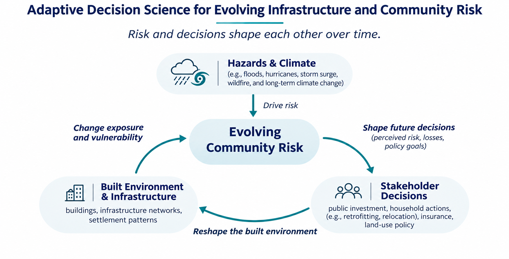
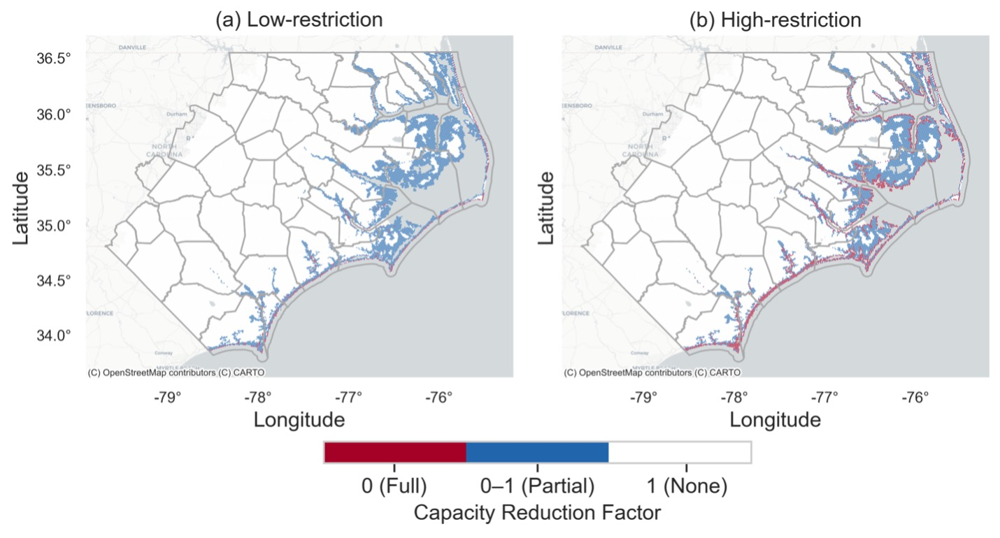
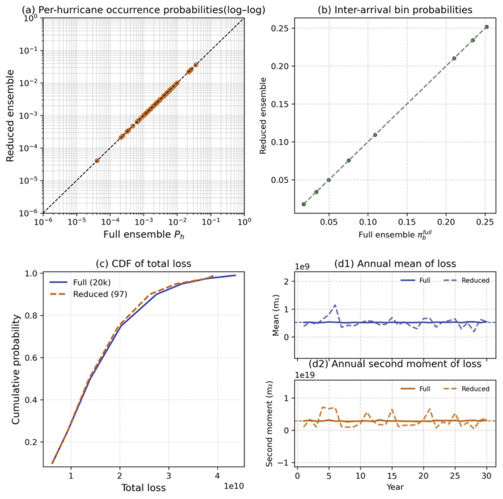
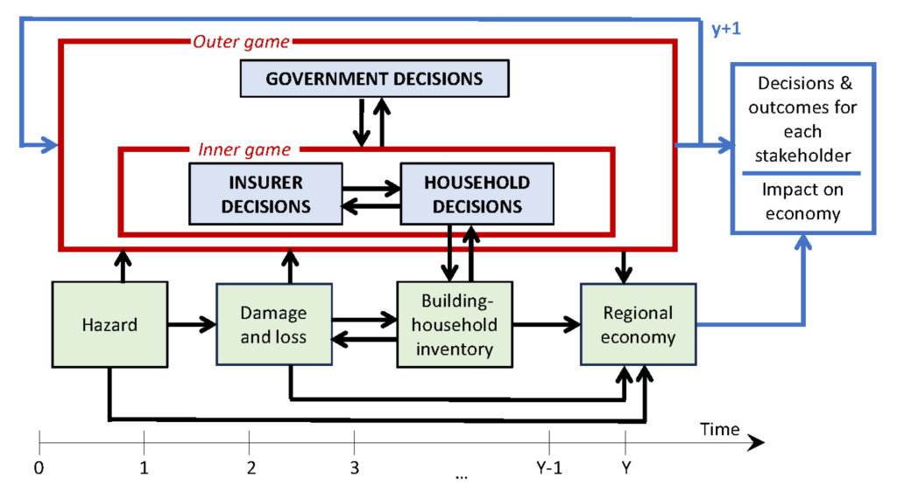
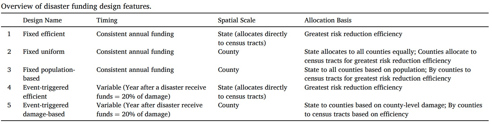
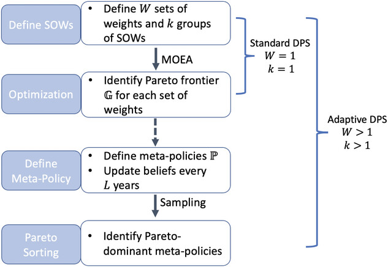

---
title: "Research"
---

::: {.research-hero}

::: {.hero-figure-full}

:::

::: {.hero-text}

**How should decisions be made and adapted when hazards, infrastructure, development, and stakeholder behavior evolve together?**

My research examines how disaster risk and decisions shape each other over time. I combine physically grounded risk modeling with adaptive decision science to investigate how infrastructure investments, public policies, and stakeholder behavior reshape future risk, and how decisions should respond as conditions and information change.

My work integrates hazard and loss modeling, dynamic exposure, multi-stakeholder simulation, optimization, and learning-based methods to inform long-term infrastructure and community resilience.

:::

::: {.hero-tags}

Evolving Risk & Built Environment
Interacting Interventions & Stakeholders
Adaptive Decisions under Uncertainty

:::

:::

---

## Research Themes

::: {.research-project}

::: {.research-project-figure}

:::

::: {.research-project-text}

### Evolving Risk and the Built Environment {#evolving-risk}

**How do hazards, development, and changes in the built environment shape future disaster risk?**

My research develops physically grounded and computationally efficient approaches to understanding how disaster risk evolves over time. I model hazard and loss processes, dynamic building inventories, and changing exposure to examine how development patterns and land-use decisions affect future losses. I also develop methods for representing long-term hazard uncertainty efficiently, enabling regional-scale risk analysis and evaluation of infrastructure and policy interventions.

**Selected publications**

Wang, J., Williams, C., Davidson, R., Nozick, L., & Millea, M. (2026). *Coupling Land Use Planning and Multi-Stakeholder Dynamics to Inform Disaster Risk Management: Who Pays for Risk and Who Gains from Intervention?* *International Journal of Disaster Risk Reduction*, 142, 106222. [DOI](https://doi.org/10.1016/j.ijdrr.2026.106222)

Wang, J., Davidson, R. A., & Nozick, L. K. (2026). *An Optimization-Based Approach to Developing Computationally Efficient Long-Term Event-Loss Scenario Ensembles.* *ASCE-ASME Journal of Risk and Uncertainty in Engineering Systems, Part A: Civil Engineering*, 12(4). [DOI](https://doi.org/10.1061/AJRUA6.RUENG-2004)

Wang, J., Williams, C., Davidson, R., Nozick, L., & Millea, M. (2026). *A Multi-Stakeholder Analysis of the Effects of Building Inventory Dynamics and Land Use Planning on Disaster Risk.* In *Proceedings of the 13th U.S. National Conference on Earthquake Engineering (13NCEE)*, Portland, OR. [Conference Paper](https://eeri.secure-platform.com/13ncee/solicitations/103002/sessiongallery/95103/application/4577)

:::

:::

::: {.research-project}

::: {.research-project-figure}

:::

::: {.research-project-text}

### Interacting Interventions and Stakeholder Decisions {#stakeholder-decisions}

**How do public interventions and stakeholder responses interact to shape risk reduction and who benefits?**

My research examines how decisions by governments, insurers, households, and other stakeholders interact to shape long-term disaster risk. Using multi-stakeholder simulation, I investigate how land-use policies, public mitigation funding, property-level adaptation, and insurance influence risk, incentives, affordability, and the distribution of benefits and costs across communities.

In related research, I examine how housing occupancy and tenure affect disaster risk and mitigation decisions. This work distinguishes owner-occupied, long-term rental, short-term rental, and vacant properties, accounting for differences in decision authority, financial responsibilities, and incentives among property owners, landlords, and tenants.

**Selected publications**

Wang, J., Siders, A. R., Davidson, R., & Nozick, L. K. (2026). *Stakeholder Dynamics in Disaster Mitigation Funding: The Roles of Timing, Spatial Scale and Allocation Basis in Policy Design.* *International Journal of Disaster Risk Reduction*, 138, 106120. [DOI](https://doi.org/10.1016/j.ijdrr.2026.106120)

Davidson, R. A., Nozick, L. K., Kruse, J., Trainor, J., Millea, M., Sue Wing, I., Liu, D., Williams, C., & Wang, J. (2025). *Stakeholder-based tool for the analysis of regional risk.* *Natural Hazards Review*, 26(3), 04025031. [DOI](https://doi.org/10.1061/NHREFO.NHENG-2321)

:::

:::

::: {.research-project}

::: {.research-project-figure}

:::

::: {.research-project-text}

### Adaptive Decision-Making under Deep Uncertainty {#adaptive-decisions}

**How should infrastructure and risk-management decisions adapt as conditions, risks, and information evolve?**

My research develops optimization and learning-based methods for designing adaptive strategies under deep uncertainty. My doctoral work integrated reinforcement learning, direct policy search, and belief updating to develop flood risk management strategies that respond to new information. This work moves beyond evaluating fixed interventions toward designing policies that can evolve as uncertainty is reduced and conditions change.

Building on this foundation, I seek to advance adaptive decision frameworks that account for evolving physical risk, interacting interventions, and stakeholder responses, supporting more effective long-term infrastructure and community resilience planning.

**Selected publications**

Wang, J., & Johnson, D. R. (2026). *Direct Policy Search for a Risk-Based Levee Design Framework With Scenario Reduction.* *Journal of Flood Risk Management*, 19(3), e70248. [DOI](https://doi.org/10.1111/jfr3.70248)

Wang, J., & Johnson, D. R. (2024). *Incorporating learning into direct policy search for flood risk management.* *Risk Analysis*, 44(1), 190–202. [DOI](https://doi.org/10.1111/risa.14136)

Recognition: Student Merit Award (Best Student Research), Engineering and Infrastructure Specialty Group, Society for Risk Analysis (2022)

Johnson, D. R., Wang, J., Geldner, N. B., & Zehr, A. B. (2022). *Rapid, risk-based levee design framework for greater risk reduction at lower cost than standards-based design.* *Journal of Flood Risk Management*, 15(2), e12786. [DOI](https://doi.org/10.1111/jfr3.12786)

:::

:::

---

## Publications

For a complete list of publications, please see my [Google Scholar](https://scholar.google.com/citations?user=xpaSPBMAAAAJ&hl=en).
